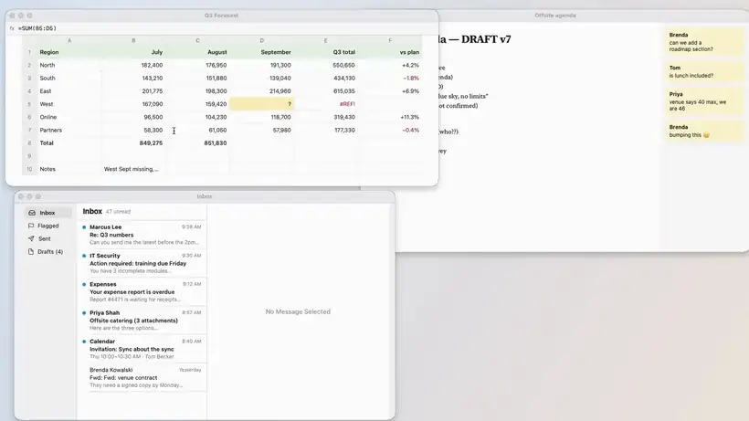
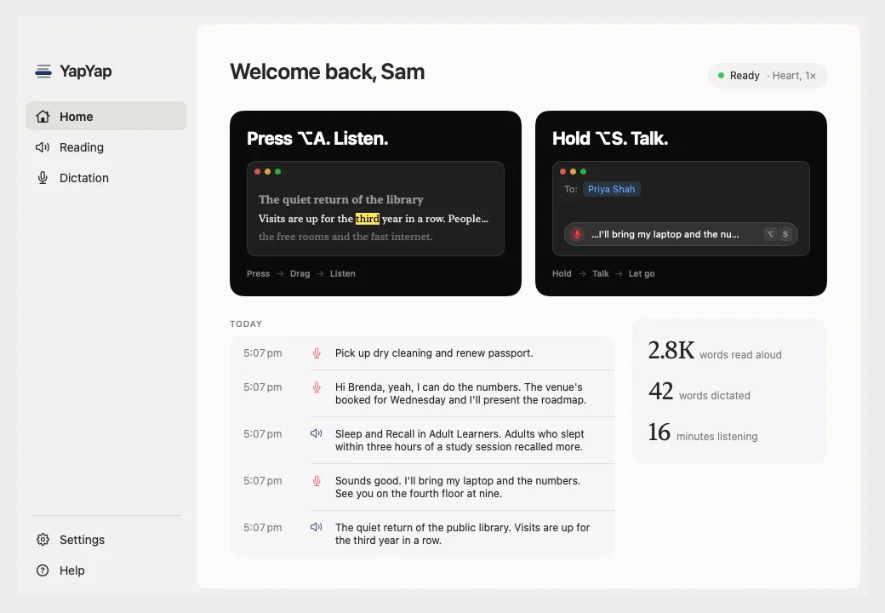
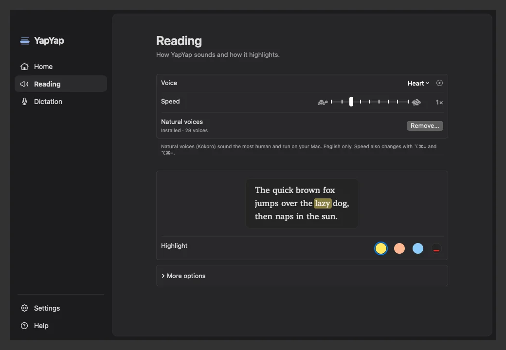
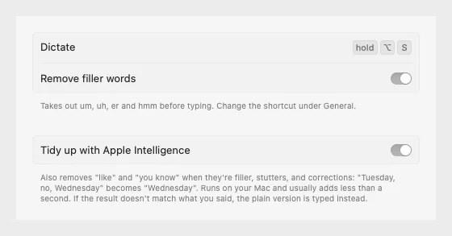
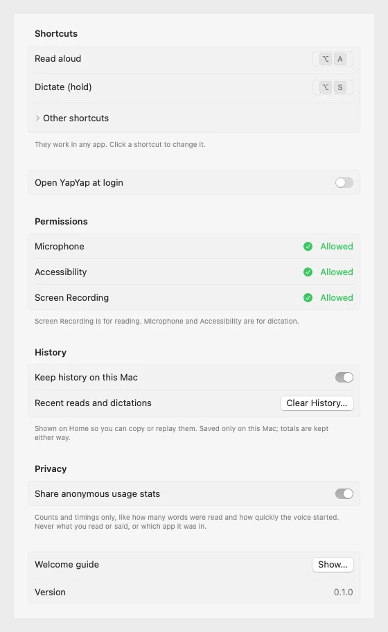
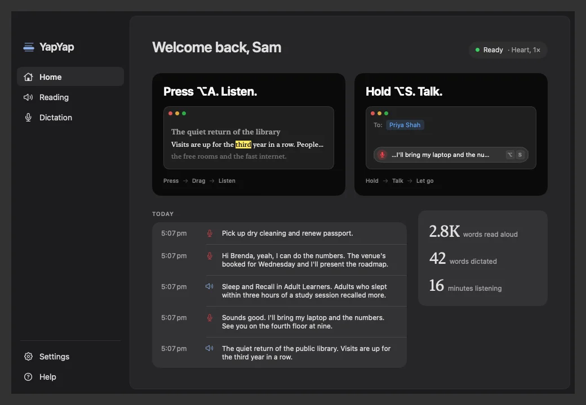
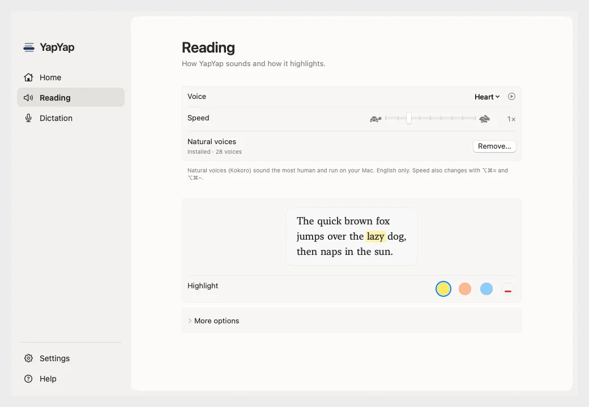

<div align="center">


# YapYap

**You talk. It types. It talks. You listen.**

A free Mac app that reads any text on your screen aloud, highlighting each word as it's spoken,
and types what you say into any app. Everything runs on your Mac.

**[Download for Mac](https://github.com/WannaBeSolopreneur/YapYap/releases/latest/download/YapYap.dmg)** · [yapyap.cc](https://yapyap.cc) · [build it yourself](#build-from-source)

[](LICENSE)




<sub>Watch it with sound on <a href="https://yapyap.cc">yapyap.cc</a>.</sub>

</div>

---

## Why

Reading a long email, a PDF or a chat thread is easier when you can listen while your eyes follow along.
Writing a reply is faster when you can just say it. Most tools that do this are subscriptions that send your
screen or your voice to a server.

YapYap does both, for free, on your Mac:

- **Press ⌥A, drag over any text, and listen.** A highlight follows each word on the original page, in any app:
  web pages, PDFs, chats, screenshots, even text inside photos.
- **Hold ⌥S and talk.** Your words appear live as you speak. Let go and they're typed wherever your cursor is.
  For longer dictation, **tap ⌥S** instead: it keeps listening until you tap it again or click ✓.
  Names on screen (the person you're emailing, a product in the chat) come out spelled right, and if there's no
  text box to type into, your words wait on the clipboard.

## Features

**Reading aloud**

- **Any app, any text:** YapYap reads what's on screen, not what an app exposes, so it works in browsers, PDFs,
  chat apps, terminals and images.
- **Word-by-word highlight on the original page,** not in a separate window. It follows the window when you move
  it, and finds its place again after you scroll or resize.
- **Real reading order:** columns, sidebars and headings are read in the right order. Web and email addresses are
  skipped (optional).
- **Natural voices from the start:** 28 Kokoro voices (US and UK English) that run on your Mac. They download in the
  background the first time you open YapYap; until then, or if you remove them, it uses the voices built into macOS.
- **Control it from the keyboard:** pause, skip sentences, change speed (0.5× to 2.5×), or ⌥-click any word to jump to it.

**Dictation**

- **Hold to talk, let go to type,** in any app with a text field: Messages, Mail, Notes, Slack, your code editor,
  even Terminal.
- **Clean text:** "um", "uh" and friends are removed. On macOS 26 with Apple Intelligence, an on-device model also
  drops filler "like"s, stutters and self-corrections ("Tuesday, no, Wednesday" becomes "Wednesday").
- **Never makes things up:** if the tidy-up adds a word you didn't say, YapYap types your plain words instead.
- **Your clipboard is put back** after typing.

**And**

- A **Home page** with your recent reads and dictations (stored only on your Mac, and you can turn it off).
- A **menu bar icon**, a floating reading bar and a small dictation capsule that only appear while in use.
- **Light and dark mode**, with Liquid Glass on macOS 26.

## Screenshots

| Home | Reading settings |
|---|---|
|  |  |
| **Dictation settings** | **General settings** |
|  |  |

<details>
<summary>Dark and light versions</summary>




</details>

The names and text in the screenshots are made up (`YapYap --snapshots <dir> --sample`).

## Keyboard shortcuts

| Keys | Action |
|---|---|
| ⌥A | Drag over any part of the screen to read it |
| ⌥⌘R | Read the front window |
| Hold ⌥S | Dictate: talk, then let go to type |
| Tap ⌥S | Dictate hands-free: keeps listening until you tap ⌥S again or click ✓ (Esc cancels) |
| ⌥⌘P | Pause or resume |
| ⌥⌘= / ⌥⌘- | Faster / slower |
| ⌥ + click | Read from that word |
| Esc | Stop reading |

⌥A and ⌥S can be changed in Settings → General. All shortcuts work in any app.

## Privacy, and how to check it

What you read and say never leaves your Mac.

- **Screen:** each read takes one still image of the window or box you chose. Apple's Vision framework turns it into
  text on your Mac, then the image is thrown away. Nothing is recorded or saved. When you dictate, YapYap does the
  same with the window you're typing in, only to pick out names so they're spelled right
  ([`ScreenContext.swift`](Sources/YapYap/ScreenContext.swift); turn it off in Settings → Dictation).
- **Voice:** dictation uses Apple's on-device speech recognition. The microphone is on only while you dictate:
  while you hold the shortcut, or in hands-free mode until you stop it (at most 10 minutes). Audio is never saved. The optional tidy-up uses Apple Intelligence on your Mac, never Private
  Cloud Compute.
- **Speech:** the Kokoro voices run locally with [MLX](https://github.com/ml-explore/mlx-swift).
- **Two one-time downloads:** the Kokoro voices (about 340 MB, from GitHub, fetched in the background on first
  launch; remove them in Settings → Reading and they stay gone), and on macOS 26 Apple's speech
  model, which macOS fetches itself.
- **Anonymous stats:** official builds send anonymous counts through [TelemetryDeck](https://telemetrydeck.com),
  like how many words were read and how quickly the voice started. Never text, audio, window titles or app names.
  Turn it off in Settings → Privacy. Builds from this repo send nothing unless you add your own TelemetryDeck App ID.
  Every signal is listed in [`Telemetry.swift`](Sources/YapYap/Telemetry.swift).

Check it yourself:

```console
$ grep -rnE 'URLSession\(|https://' Sources
Sources/YapYap/Kokoro.swift:253:   …/kokoro-v1_0.safetensors
Sources/YapYap/Kokoro.swift:254:   …/voices.npz
Sources/YapYap/AppModel.swift:395: session = URLSession(configuration: …)
```

That's all of YapYap's own network code: the voice download. The only other connections are TelemetryDeck's
anonymous stats and Sparkle's daily update check (`yapyap.cc/appcast.xml`, then the new version from GitHub). Turn off Wi-Fi once the voices are installed and reading and dictation work the same, or watch
with a network monitor such as [LuLu](https://objective-see.org/products/lulu.html).

> [!NOTE]
> YapYap asks for **Screen Recording** (to see the text you ask it to read), **Microphone** (to hear you while you
> hold ⌥S) and **Accessibility** (to type your words by sending ⌘V). Without Accessibility, dictated text is left on
> your clipboard to paste yourself.

## Install

**[Download YapYap](https://github.com/WannaBeSolopreneur/YapYap/releases/latest/download/YapYap.dmg)**, open it,
and drag YapYap onto Applications. It's signed and notarized by Apple and keeps itself up to date. Requires macOS 15
or later on Apple silicon. All versions are on the [releases page](https://github.com/WannaBeSolopreneur/YapYap/releases).

### Build from source

Requirements: a Mac with Apple silicon, macOS 15 or later, and Xcode 16 or later.

```bash
git clone https://github.com/WannaBeSolopreneur/YapYap.git
cd YapYap
scripts/make-signing-cert.sh       # once: a local certificate, so macOS keeps your permissions across rebuilds
scripts/build-app.sh --install     # build, copy to /Applications and launch
```

The first launch walks you through the three permissions and a quick try-out. Use `xcodebuild` (the scripts do),
not `swift build`: MLX needs its Metal shaders compiled, and SwiftPM's command line can't handle KokoroSwift's
dynamic library.

## How it works

```
Reading   ⌥A / ⌥⌘R ─► Capture ─► OCR ─► Layout ─► Doc ─► Kokoro or system voice ─► word timings
          (one still)  (Vision)  (reading order)  (words + boxes)                       │
                                                                     Overlay ◄──────────┘  highlight on the page

Dictation hold ⌥S ─► Transcriber ─► Fillers ─► Apple Intelligence tidy-up ─► Paster
                     (on-device)    (um, uh)   (checked: no new words)       (clipboard + ⌘V, restored)
```

1. **Capture.** ScreenCaptureKit takes one image of the chosen window or region. Our own panels are left out.
2. **Recognise.** Vision finds every word and its box. `Layout` puts lines and blocks in reading order with an
   XY-cut, so columns and sidebars come out right, and builds a `Doc`: the text plus each word's position.
3. **Speak.** `VoiceRouter` picks Kokoro (Kokoro-82M on MLX, spoken in sentence chunks with per-word timestamps) or
   `AVSpeechSynthesizer`. As each word is spoken, `OverlayPanel` (click-through, hidden from screen capture)
   highlights it on the original app. If you scroll or resize, YapYap captures again and `Align` finds the current
   word in the new layout.
4. **Dictate.** While ⌥S is held, `Transcriber` streams the microphone through `SpeechAnalyzer` on macOS 26 (or
   `SFSpeechRecognizer` on macOS 15). On release, `Fillers` strips filler words, `Polisher` optionally tidies the
   text with the on-device `SystemLanguageModel`, `Fillers.isFaithful` rejects anything that adds words you didn't
   say, and `Paster` types it with ⌘V before restoring your clipboard.

## Project tour

| Path | What's there |
|---|---|
| `Sources/YapYapCore/` | Pure, unit-tested logic: OCR to `Doc`, reading order (`Layout`), re-alignment after scroll (`Align`), filler words, transcripts |
| `Sources/YapYap/Controller.swift` | The reading pipeline: capture → OCR → speech → highlight |
| `Sources/YapYap/Kokoro.swift`, `Speaker.swift` | The Kokoro voice (download, MLX synthesis, word timings) and the macOS system voice |
| `Sources/YapYap/Dictation.swift`, `Polish.swift` | Hold-to-talk dictation, speech recognition, Apple Intelligence tidy-up, typing |
| `Sources/YapYap/AppModel.swift` | The observable state every window reads |
| `Sources/YapYap/AppShell.swift`, `HomeView.swift`, `SettingsView.swift`, `WelcomeView.swift` | The SwiftUI windows |
| `Sources/YapYap/Overlay.swift`, `PlayerBar.swift`, `DictationBar.swift`, `RegionSelector.swift` | The floating highlight, reading bar, dictation capsule and region picker |
| `Sources/YapYap/Telemetry.swift` | Every anonymous stat YapYap can send, in one file |
| `Tests/` | Unit tests for the core and the app model |
| `scripts/` | Build, signing, notarized release |
| `site/`, `web/` | The [yapyap.cc](https://yapyap.cc) website and its Cloudflare Worker |

## Testing

```bash
xcodebuild test -scheme YapYap -destination 'platform=macOS,arch=arm64' -derivedDataPath .build/xcode
```

The app also has command-line modes for checking each stage on its own:

```bash
APP=build/YapYap.app/Contents/MacOS/YapYap
$APP --ocr screenshot.png              # text in reading order
$APP --boxes in.png out.png            # draw the word boxes the highlight uses
$APP --kokoro "Some text."             # speak with Kokoro and print word timings
$APP --transcribe talk.wav             # run a recording through dictation (macOS 26+)
$APP --polish "um, so, uh, hi"         # filler removal and Apple Intelligence tidy-up
$APP --snapshots shots/ --sample       # render every screen, light and dark, with made-up data
open --stdout /dev/stdout -a /Applications/YapYap.app --args --permissions   # what the installed app is allowed
```

## Releasing

```bash
scripts/release.sh 1.0.0              # build/release-1.0.0/YapYap.dmg, signed, nothing sent anywhere
scripts/release.sh 1.0.0 --notarize   # also notarize with Apple, staple, and add it to site/appcast.xml
```

Then publish a GitHub release `v1.0.0` with that `YapYap.dmg`, and deploy the site so the update feed
(`https://yapyap.cc/appcast.xml`) lists it. The build number counts up on its own.

Builds use the hardened runtime (`scripts/YapYap.entitlements`). With a "Developer ID Application" certificate in
your keychain, `build-app.sh` signs with it; otherwise it uses the local certificate. Notarizing needs credentials
saved once with `xcrun notarytool store-credentials yapyap-notary --apple-id <id> --team-id <team>`. Private
settings, like a TelemetryDeck App ID, go in `scripts/local.env` (see `scripts/local.env.example`), which git ignores.

**Updates** use [Sparkle](https://sparkle-project.org) (`Updates.swift`). Each release is signed with an EdDSA key
kept in the release machine's keychain; the app only installs updates signed with it (`SUPublicEDKey` in
`build-app.sh`). Forks should generate their own key and feed, or remove the two `SU…` keys to turn updates off.

## Roadmap

- Read straight from apps' accessibility text where it's available, and keep reading past the bottom of the screen
- More languages

## Contributing

Issues and pull requests are welcome. Please keep the core promise intact: nothing a person reads or says leaves
their Mac, and every anonymous stat stays a number or a value from a fixed list. Never put real personal data in
tests or screenshots; `--snapshots --sample` renders the app with made-up data.

## License

YapYap is free software under the [GNU Affero General Public License v3.0](LICENSE). You can use, study, change
and share it. If you ship a modified version, including as a paid app or a service, you must publish its full source
under the same license. Bundled libraries and the Kokoro voices keep their own licences; see [NOTICE](NOTICE).

Copyright © 2026 Asad Moulvi
